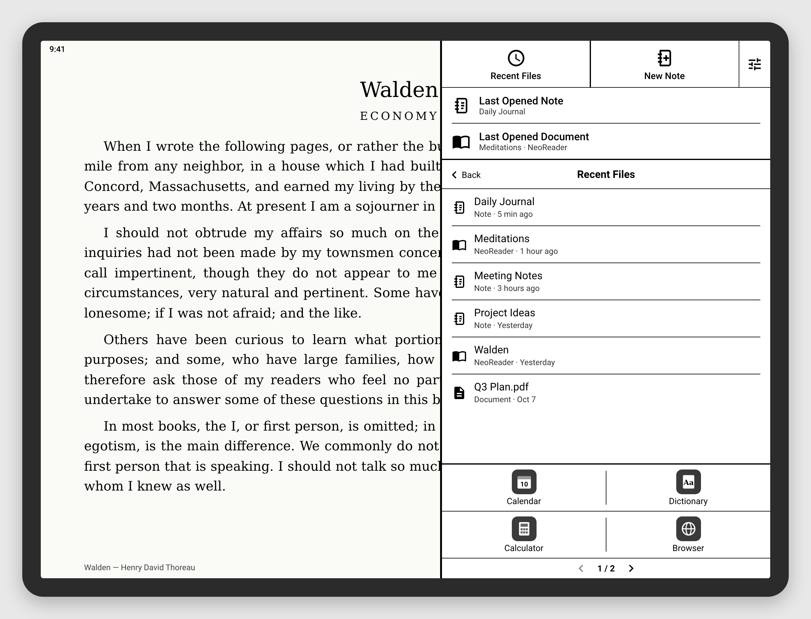
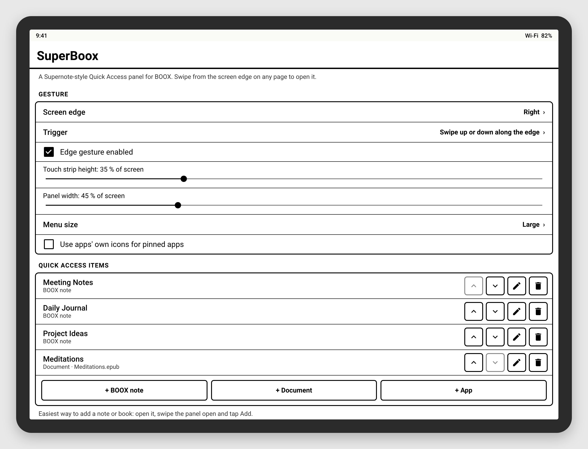

# SuperBoox

A Supernote-style **Quick Access panel** for ONYX BOOX e-ink tablets.

Swipe along the right edge of the screen on any page, and a panel slides in with your pinned notes and books, the last note and document you had open, a New Note button, and your apps. Tap a pinned note and it opens directly in BOOX Notes, even from inside another note.


## What's in the panel

- **Recent Files**: notes and books you opened recently, newest first.
- **New Note**: opens BOOX's new-note screen.
- **Last Opened Note**: reopens the note you had open before the current one.
- **Last Opened Document**: reopens the last book or PDF from NeoReader, straight to the file. Other reading apps (KOReader, Kindle and so on) are brought back to the front.
- **Quick Access**: your pinned items. Each one shows an icon for its kind: note, book, file, folder, app or link. Tap **Add** to pin something:
  - inside a note, Add pins that note;
  - in NeoReader, Add pins the book that's open;
  - in the Notes library, Add opens a picker where you tick several notes at once;
  - anywhere else, Add pins the current app.
- **Long-press** a pinned item to reorder or remove items.
- **Quick Controls** (optional): a paged row of round toggles like the BOOX Control Center. Wi‑Fi, Bluetooth, Do Not Disturb, Auto-rotate, Full Refresh, Back/Home/Recents and more. Tap switches; hold opens its settings. **Front Light** switches on and off; hold it for Bright, Soft, Custom and Off, Custom's brightness and warmth, and your own presets.
- **Apps** along the bottom, 4 per page, optionally with **Previous app**.

It's black on white with no animations, so it draws cleanly on e-ink. Menu size, panel width, the screen edge and the gesture can all be changed in Settings.



## Install

1. Install [Obtainium](https://github.com/ImranR98/Obtainium) on the BOOX. In Obtainium, tap **Add App**, paste `https://github.com/rn-os/superboox`, then tap **Add** and **Install**. Obtainium will let you know when there's a new build.
   You can also download the latest `superboox-build-N.apk` from [Releases](https://github.com/rn-os/superboox/releases) and open it on the device.
2. Open **SuperBoox**, tap **Accessibility settings** and turn on **SuperBoox Quick Access**.
3. **BOOX only:** go to *Settings → Apps → App Management → SuperBoox* and allow it to run in the background (turn off freezing). Otherwise BOOX may stop it after the device sleeps.
4. Swipe up or down along the right edge of the screen.

No computer or adb needed.



## Other ways to open the panel

| Method | Notes |
|---|---|
| Edge gesture | Swipe along the edge (default), swipe inward, or double-tap. Pick the edge, strip size and position in Settings. |
| **Quick Access** app icon | Opens the panel. You can assign it to a BOOX gesture or the Navigation Ball if you'd rather not reserve a strip of the screen edge. |
| Quick Settings tile | Add **Quick Access** to the notification shade. |

## How notes and books are opened

- **Notes.** BOOX Notes shares a small database of note names and IDs with other apps. When you pin a note, SuperBoox saves its ID, so a pin keeps working after you rename the note. Tapping it opens the note through BOOX's own "open note" screen. If another note is open, SuperBoox closes it first with Back, so BOOX saves it. If a direct open ever fails, SuperBoox falls back to finding the note in the Notes library for you. While that runs, the screen holds still, so you don't see the home screen flash by.
- **Books.** NeoReader shares its library the same way. When you pin a book, SuperBoox saves its file location and opens it in NeoReader directly.

SuperBoox reads only names, IDs, file locations and when things were opened. It never reads the contents of your notes or books.

Tested on a Note Air 6C (Android 16, firmware 4.3). Other BOOX models and firmware should work, but haven't been tested yet. Bug reports are welcome.

## Backup & restore

**Settings → Backup & restore** saves every SuperBoox setting (pins, Quick Controls, Front Light presets, apps, gesture and look) to one small file you keep wherever you like, and restores it later. Lists in Settings can be reordered by dragging ≡ or with the arrows.

## Privacy

- No permissions beyond the accessibility service you turn on, plus an optional "Modify system settings" that the Auto-rotate Quick Control asks for so it can switch rotation in one tap. **No internet access.**
- Everything stays on the device: pins, recents and the troubleshooting log.

## Reporting bugs

Open **SuperBoox → Troubleshooting → Copy debug report** (or **Share…**) and paste it into a [GitHub issue](https://github.com/rn-os/superboox/issues). The report includes:

- your device and firmware;
- your SuperBoox settings and pinned items, including their names;
- a log of what SuperBoox did: gestures, the app in front, launches, and each step of opening a note.

Look it over before you post it. The report stays on the device unless you copy or share it, and **Clear log** empties the log.

## How it works

```
QuickAccessService (AccessibilityService)
 ├─ EdgeHandleView      thin overlay strip on the screen edge, detects the gesture
 ├─ QuickAccessPanel    the panel: top buttons, last opened, Quick Access, Recent Files, apps
 ├─ NoteOpener          opens a note by ID; falls back to navigating the Notes library
 ├─ OpeningCover        holds the current screen while a note opens
 └─ tracks the app in front (for Add and the recents)
NotesDb / NoteIds       BOOX Notes database: note names and IDs
ReaderLibrary           NeoReader library: book titles and file locations
SettingsActivity        setup, gesture, pins, apps, recent folder, troubleshooting
OpenPanelActivity       opens the panel from the app icon or a BOOX gesture
PanelTileService        Quick Settings tile
```

An accessibility overlay draws above everything, including the BOOX launcher. BOOX leaves accessibility services running, and the service can read which note or book is on screen, which Add needs.

There are no dependencies beyond the Android framework and the Kotlin standard library. The UI is built in code (`Ui.kt`).

## Building

`./gradlew assembleDebug` needs JDK 17 and the Android SDK. Every push builds an APK and publishes it as a GitHub release.
