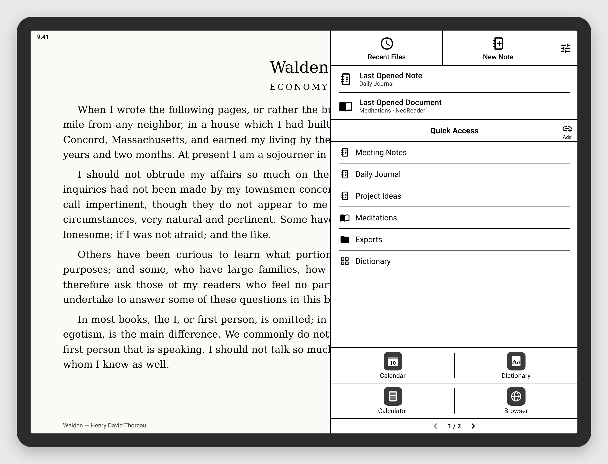
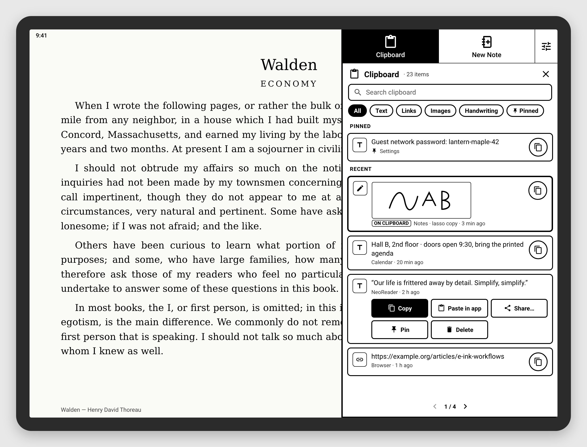
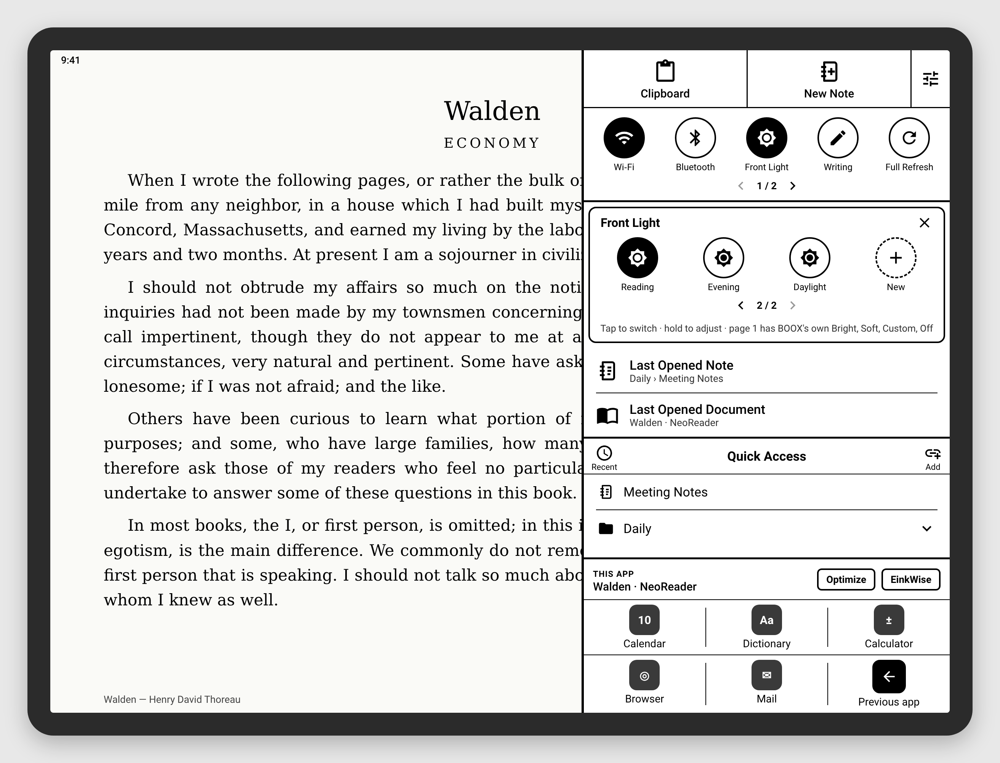
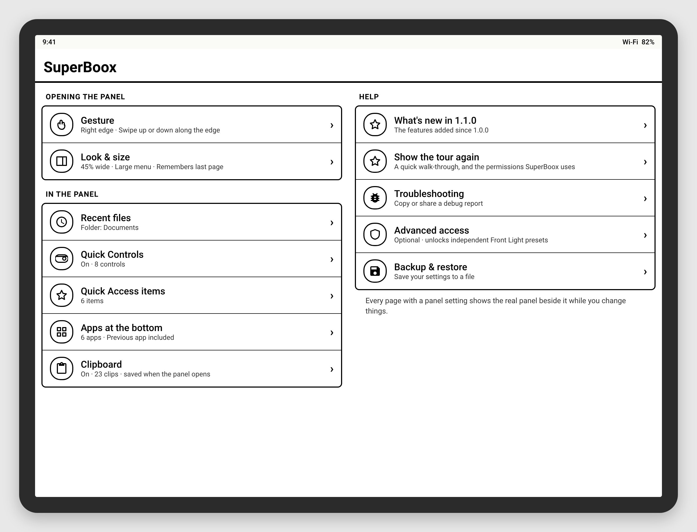

# SuperBoox

A Supernote-style **Quick Access panel** for ONYX BOOX e-ink tablets.

Swipe along the edge of the screen on any page, and a panel slides in. It holds:

- your pinned notes, books, folders and apps
- the last note and document you had open
- quick switches such as Wi‑Fi and Front Light
- a clipboard history that also keeps handwriting copied from BOOX Notes
- your apps

Tap a pinned note and it opens directly in BOOX Notes, even from inside another note.

No computer or adb needed. No internet permission.



## Getting started

1. **Install.** Install [Obtainium](https://github.com/ImranR98/Obtainium) on the BOOX. In Obtainium, tap **Add App**, paste `https://github.com/rn-os/superboox`, then tap **Add** and **Install**. Obtainium will let you know when there's a new build.
   You can also download the latest `superboox-build-N.apk` from [Releases](https://github.com/rn-os/superboox/releases) and open it on the device.
2. **Open SuperBoox.** A short tour (8 steps, with Next, Previous and Skip) walks you through:
   - **Turning on the service.** Android settings → Accessibility → SuperBoox Quick Access → On. This is the only required step.
   - **Trying it.** Your swipe strip is drawn in black, so you can see where to swipe.
   - **A guided look at the real panel** and the clipboard.
   - **Permissions,** each with a button and a line about why. All are optional:
     - Battery: so BOOX doesn't stop SuperBoox while the tablet sleeps
     - Modify system settings: for one-tap Auto-rotate
     - All files access: to show copied handwriting
3. **BOOX only:** go to *Settings → Apps → App Management → SuperBoox* and allow it to run in the background (turn off freezing).
4. **Swipe** up or down along the right edge of the screen.

You can replay the tour any time from **Settings → Help → Show the tour again**.

## What's in the panel

From top to bottom:

| Part | Tap | Hold |
|---|---|---|
| **Clipboard** (top bar) | Opens your clipboard history in the panel | Opens Settings → Clipboard |
| **New Note** (top bar) | Makes a new note | Opens BOOX's own create-note screen on your recent templates, to pick a name, template and layout. Back or Cancel returns you to where you were, not BOOX's home screen |
| **⚙** (top bar) | Opens Settings | |
| **Quick Controls** | Switches Wi‑Fi, Bluetooth, Do Not Disturb, Auto-rotate, Full Refresh, Back/Home/Recents and more | Opens that control's settings |
| **Front Light** control | Turns the light on or off | Shows the presets (see below) |
| **Writing** control (add it in Settings → Quick Controls) | Turns off Wi‑Fi, Bluetooth and the Front Light together; tap again to put back what it switched | Opens its settings |
| **Last Opened Note / Document** | Reopens the note you had open before this one, or the last book or PDF | |
| **Last Opened Note / Document** | Reopens the note you had open before this one, or the last book or PDF | Note: BOOX Notes' library, in that note's folder. Document: its app's start screen (NeoReader: BOOX's Library) |
| **Recent** (on the Quick Access bar) | Lists recently opened notes and books, newest first | |
| **Quick Access** | Opens a pinned item | Lets you drag to reorder or remove items |
| **Add** (on the Quick Access bar) | Pins what's open (see below) | |
| **This app** (above the apps, BOOX only) | **Optimize** opens BOOX's Customize panel (refresh, display and, on color screens, color) for the app that's open; **EinkWise** opens BOOX's E-Ink Center. Both open over the app, and changes apply while it runs | |
| **Apps** along the bottom | Opens the app; swipe for more pages. **Previous app** can be one of them | |

What **Add** pins depends on where you are:
- inside a note: that note
- in NeoReader: the book that's open
- in the Notes library: opens a picker so you can tick several notes at once
- anywhere else: the current app

The panel is black on white with no animations, so it draws cleanly on e-ink. Its width, the menu size, the screen edge and the gesture can all be changed in Settings.

### Clipboard



The clipboard is meant to be a hub for carrying things between apps.

**Opening it.** Tap **Clipboard** in the top bar. By default it takes over the whole panel. You can keep Quick Controls, Last Opened or the apps showing beside it.

**What it keeps:**
- text
- links
- images
- **handwriting** you lasso-copy in BOOX Notes, shown as a picture of what you wrote

Pinned clips stay on top. Search the history, or filter it with **All · Text · Links · Images · Handwriting · Pinned**.

**Using a clip.** Tap ⧉ to copy it again. Tap or hold the clip itself for more:
- Copy
- Paste in app
- Open (links)
- Share…
- Pin
- Delete

**Settings → Clipboard** lets you choose:
- which kinds to keep (each with a short description; one-time codes are off by default)
- how many items to keep
- whether to keep images
- whether to keep the history after a restart
- apps to ignore
- how much of the panel it covers (with a live preview)

**When copies are saved.** By default, whatever is on the clipboard is saved each time you open the panel. That needs no setup. To catch every copy as it happens, turn on [Advanced access](#advanced-access-optional).

**Handwriting pictures** need **All files access**, which lets SuperBoox read the copy that BOOX Notes leaves on the device. Without it, handwriting clips still copy and paste back into Notes; they just show a pen icon instead of the picture.

### Front Light presets



Hold **Front Light** to get a small box in the panel. It opens on the page with the active preset.

- **Page 1** has BOOX's own presets: **Bright**, **Soft**, **Custom** and **Off**. Hold **Custom** to set its brightness and warmth.
- **The next pages** hold your own named presets. Tap one to switch to it, hold it to adjust its levels or rename it, or tap **+ New** to make one.

Your own presets need Advanced access, so that setting one doesn't overwrite BOOX's Custom.

## Settings



Settings is grouped into three sections.

**Opening the panel:**
- **Gesture.** Which edge, swipe along or swipe in or double-tap, and the strip's size and position. While you change these, the real strip is drawn on the screen.
- **Look & size.** Panel width, menu size, and whether it remembers the last page.

**In the panel:**
- **Recent files**
- **Quick Controls**
- **Quick Access items**
- **Apps at the bottom.** You can rename an app's label.
- **Clipboard**

Pages that change the panel can show the **real panel beside them** while you adjust them. This works in portrait and landscape. **Show me** buttons draw what an option does.

**Help:**
- **Show the tour again**
- **Troubleshooting**
- **Advanced access**
- **Backup & restore.** Saves every setting (pins, Quick Controls, Front Light presets, apps, clipboard choices, gesture and look) to one small file you keep wherever you like, and restores it later.
- **Advanced**

## Other ways to open the panel

| Method | Notes |
|---|---|
| Edge gesture | Swipe along the edge (default), swipe inward, or double-tap. Pick the edge, strip size and position in Settings. |
| **Quick Access** app icon | Opens the panel. You can assign it to a BOOX gesture or the Navigation Ball if you'd rather not reserve a strip of the screen edge. |
| Quick Settings tile | Add **Quick Access** to the notification shade. |

## Advanced access (optional)

Everything above works without it.

Advanced access uses the free [Shizuku](https://shizuku.rikka.app/) app, which runs on-device ADB over wireless debugging. No computer is needed. Settings → Advanced access walks you through it.

It unlocks two things:
- your own Front Light presets that don't touch BOOX's Custom
- saving every copy to the clipboard history as it happens

After the tablet restarts, Shizuku has to be started again. SuperBoox tells you when that's the case.

## How notes and books are opened

- **Notes.**
  - BOOX Notes shares a small database of note names and IDs with other apps. When you pin a note, SuperBoox saves its ID, so the pin keeps working after you rename the note.
  - Tapping a pin opens the note through BOOX's own "open note" screen. If another note is open, SuperBoox closes it first with Back, so BOOX saves it.
  - If a direct open ever fails, SuperBoox falls back to finding the note in the Notes library for you. While that runs, the screen holds still.
- **Books.** NeoReader shares its library the same way. When you pin a book, SuperBoox saves its file location and opens it in NeoReader directly. Other reading apps (KOReader, Kindle and so on) are brought back to the front.

Tested on a Note Air 6C (Android 16, firmware 4.3). Other BOOX models and firmware should work, but haven't been tested yet. Bug reports are welcome.

## Privacy

- **No internet permission.** Nothing leaves the tablet unless you copy or share it yourself.
- Pins, recents, the clipboard history and the troubleshooting log are stored on the device only. **Clear history** and **Clear log** empty them.
- For notes and books, SuperBoox reads only names, IDs, file locations and when things were opened. It never reads what's inside them.
- Permissions:
  - **Required:** the accessibility service.
  - **Optional:**
    - Modify system settings (Auto-rotate)
    - Ignore battery optimisation (keeps it running)
    - All files access (handwriting pictures). This is used only to read the copy BOOX Notes makes when you lasso-copy.
    - Shizuku (Advanced access)

## If the panel stops opening

SuperBoox catches errors in Settings and the panel and recovers by itself, so changing settings shouldn't stop it. If it does stop, the top of Settings shows it.
- **Running but misbehaving:** tap **Restart service**.
- **Turned on, but stopped:** Android keeps an accessibility service stopped after an error until it's switched off and on again. **Restart service** does that for you with Advanced access. Without it, Restart service opens SuperBoox's switch so you can turn it off and on.

## Reporting bugs

Open **SuperBoox → Troubleshooting → Copy debug report** (or **Share…**) and paste it into a [GitHub issue](https://github.com/rn-os/superboox/issues).

The report includes:
- your device and firmware
- your SuperBoox settings and pinned items, including their names
- clipboard **counts** only (never what you copied)
- a log of what SuperBoox did: gestures, the app in front, launches, and each step of opening a note

Look it over before you post it.

## How it works

```
QuickAccessService (AccessibilityService)
 ├─ EdgeHandleView      thin overlay strip on the screen edge, detects the gesture
 ├─ QuickAccessPanel    the panel: top bar, Quick Controls, Front Light presets, last opened,
 │                      Quick Access, Recent, clipboard, apps; also the live preview in Settings
 ├─ NoteOpener          opens a note by ID; opens BOOX's create-note screen (hold New Note)
 ├─ OpeningCover        holds the current screen while a note opens
 └─ tracks the app in front (for Add and the recents) and checks the clipboard
ClipHistory             clipboard history, kept on the device; reads handwriting copies
BooxShapes              draws BOOX Notes' copied handwriting (shape.pb) as a picture
QuickControls           the switches and Front Light presets
AdvancedAccess          optional Shizuku connection (presets, background clipboard)
NotesDb / NoteIds       BOOX Notes database: note names and IDs
NotesScreen             recognises BOOX Notes screens (open note, create-note screen)
ReaderLibrary           NeoReader library: book titles and file locations
Recents                 recently opened notes and documents
SettingsActivity        tour, settings pages, live preview, troubleshooting
Backup                  saves and restores settings to a file
OpenPanelActivity       opens the panel from the app icon or a BOOX gesture
PanelTileService        Quick Settings tile
```

An accessibility overlay draws above everything, including the BOOX launcher. BOOX leaves accessibility services running, and the service can read which note or book is on screen, which Add needs.

The UI is built in code (`Ui.kt`). The only libraries are Shizuku's API (used only if you turn on Advanced access) and HiddenApiBypass.

## Building

`./gradlew assembleDebug` needs JDK 17 and the Android SDK. Every push builds an APK and publishes it as a GitHub release.

The launch images are drawn from `docs/launch/launch.html`, with made-up names and a public-domain book.
